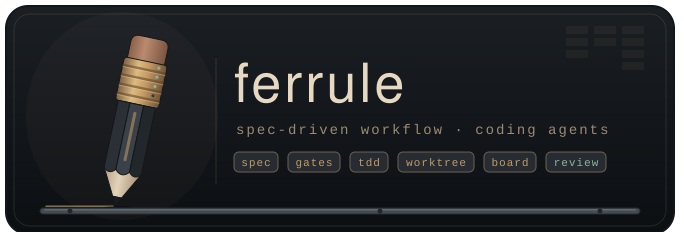
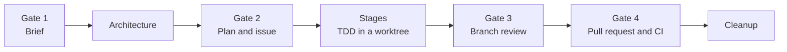

# Ferrule - A spec-driven workflow for coding agents

[](#) [](https://github.com/TumbleOwlee/ferrule/actions/workflows/release.yml)

Ferrule turns a behavior change into a gated run: a brief, an architecture, a plan, test-driven stages in an isolated worktree, an independent review and a pull request. Each step is done by a dedicated agent and approved by you. The rules that hold it together (the task board, spec IDs, approvals, which git and GitHub calls are allowed) live in typed, tested Rust instead of in prompts and shell scripts, so an agent cannot quietly skip them.

> **Status:** early and under active development (v0.1). Commands and file formats may still change between releases.

## Motivation

Coding agents are good at writing code and bad at following process. Ask one to work spec-first and it will, until a shortcut looks faster: a commit straight to main, a review it runs on its own code, a spec edited after the fact. Instructions alone do not hold.

Ferrule moves the process out of the prompt:

- **State is on a board, not in the conversation.** Every step moves a card in `.ferrule/state.db`, so an interrupted run can be resumed, reconciled with git and the host, or rebuilt.
- **Instructions arrive per step.** After each agent reports, `ferrule gate next` names the one guide topic that applies now. No agent reads ahead or carries the whole workflow in context.
- **Mechanical steps are commands.** Commits, pushes, issues and PR bodies are assembled by ferrule from the run's files, never retyped by an agent.
- **Verification is re-run, not trusted.** A reported commit is checked, the gauntlet runs in the worktree, and the reviewer is always a different agent from the implementer.
- **Shortcuts are refused.** A shell guard blocks the raw git and `gh` calls ferrule replaces, and git hooks keep main untouchable whatever slipped through.

## Workflow

A run starts with `/fe-feature` in Claude Code. You approve at each gate; between gates, agents work on their own.



| Step | Agent | Produces |
|---|---|---|
| Gate 1: brief | `fe-author` | Scenarios, requirements and edge cases, grilled out of you one question at a time |
| Architecture | `fe-architect` | Types, modules, ownership and interactions, with a capped summary to approve |
| Gate 2: plan | `fe-planner` | Stages with files and dependencies, fixed spec IDs; on approval the tracking issue is filed and the worktree created |
| Stages | `fe-implementer` | Strict test-first commits, one stage at a time, pushed to a draft PR |
| Gate 3: review | `fe-reviewer` | An independent review against the spec, the architecture and the repo's standards |
| Gate 4: PR | `fe-author` | The final PR body and follow-up issues; the run ends when the PR is ready and CI is green |

Merging stays with you, outside the workflow.

**Lanes.** Small changes take the *fast* lane: fewer stops, with the brief, architecture and plan approved together. Larger changes take the *full* lane, with a stop at every gate. Ferrule proposes a lane by size and you settle it at the first stop.

**Epics.** A feature too big for one run becomes an epic: its run settles the shared core and cuts the feature into slices, each filed as an issue and later done as a normal run.

### Entry points

| Skill | Use it to |
|---|---|
| `/fe-bootstrap` | Draft the first `PRD.md`, `ARCHITECTURE.md`, spec areas and gauntlet for a repository, once after install |
| `/fe-feature` | Drive one behavior change through the full workflow |
| `/fe-request` | Turn a requirement into an approved brief and a tracking issue, and stop there |
| `/fe-review` | Review someone else's open PR against its ticket's spec |

## Quick start

Install the binary, either from a [release](https://github.com/TumbleOwlee/ferrule/releases) (Linux and Windows builds) or with Cargo:

```sh
cargo install --git https://github.com/TumbleOwlee/ferrule --tag v<version> --locked ferrule
```

Set up a repository and commit what it writes:

```sh
cd <repository>
ferrule setup install
```

Then, in Claude Code:

1. Run `/fe-bootstrap` once, so the repository has a spec to work against.
2. Run `/fe-feature` with the change you want.

## Installed files

`ferrule setup install` detects the project's stack and writes:

| Path | Committed | What |
|---|---|---|
| `.ferrule/ferrule.toml` | yes | Project settings, created once with a gauntlet for the detected stack (and `glow` as viewer when on `PATH`); later runs only move `version` |
| `.ferrule/ferrule.lock` | yes | The installed version and the hash of every generated file and block |
| `.ferrule/ferrule` | yes | Shim the hooks call: runs `ferrule`, or refuses with the install command when it is missing |
| `.ferrule/.gitignore` | yes | Ignores the board, run files and worktrees |
| `.ferrule/lefthook.yml` | yes | The git hooks, when the project uses lefthook (an `extends` block is added to its config) |
| `.claude/agents/fe-{author,architect,planner,implementer,reviewer}.md` | yes | Identity, status line, never-do rules, the first `ferrule guide` topic |
| `.claude/skills/fe-{feature,request,review,bootstrap}/SKILL.md` | yes | The entry points |
| `.claude/settings.json` | yes | The hooks and the `permissions.deny` backstop, merged into the file |
| `AGENTS.md` | yes | A block between `<!-- ferrule:begin -->` and `<!-- ferrule:end -->` |
| `CLAUDE.md` | yes | An `@AGENTS.md` line when it has none |
| `docs/specs/README.md` | yes | The ID and numbering rules, when the file is missing |
| `.git/hooks/{pre-commit,commit-msg,pre-push}` | no | Without lefthook or husky |

**Upgrading.** Install the new binary and run `ferrule setup install` again. A generated file whose hash matches the lock is replaced; one you edited is kept, with the new version next to it as `<name>.ferrule-new`. A file at a generated path that ferrule never wrote is refused unless `--force`. `ferrule setup uninstall [--purge]` removes what was added.

**Version pinning.** The project records the version it was installed with. A binary whose version differs from `ferrule.toml` or `ferrule.lock` refuses every command but `setup` and names the fix: an older binary says which tag to `cargo install`, a newer one says to run `ferrule setup install` and commit the updated files.

## Commands

Commands are grouped by what they act on. Most are run by the orchestrating agent, not by hand; the ones you are likely to type yourself are `board list`, `run status` and `guide show`. `ferrule <command> --help` prints the full help for a command, with its `Output:`, `Refusals:` and `See: ferrule guide show <topic>` sections.

### Setup

| Command | Does |
|---|---|
| `ferrule setup install [--stack s] [--force]` | Set up or upgrade `.ferrule/` and the Claude Code adapters |
| `ferrule setup check` | Fail on drift between the installed files and the binary |
| `ferrule setup uninstall [--purge]` | Remove what `setup install` added |

### Guide

| Command | Does |
|---|---|
| `ferrule guide show <topic> [--section <heading>…] [--slug <s>] [--stage s<n>] [--lane fast\|full]` | One topic, or some of its sections, cut to the run's lane, steps the card shows done marked, placeholders filled |
| `ferrule guide list` | Every topic, grouped into orchestrator and agent topics |
| `ferrule guide check` | Fail on a broken topic reference, section reference or tag |

### Run

| Command | Does |
|---|---|
| `ferrule run init <slug> [--issue <n>]` | Start a run: parent card, run directory, the named issue's request and brief; a slice's epic |
| `ferrule run status <slug>` | Where a run stands: parent and stage cards, worktree, gauntlet, CI, last event |
| `ferrule run diff <slug> [--specs] [--stat] [--base <ref>]` | The run branch's diff against main, in its worktree; `--uncommitted` for the work not yet committed |
| `ferrule run log <slug>` | The run branch's commits against main |
| `ferrule run plan-diff <slug>` | What changed in `plan.md` since the last plan review |
| `ferrule run reconcile <slug> [--local]` | Cards against git, and the issue, PR and PR body on the host, before an interrupted run resumes |
| `ferrule run rebuild <issue> <pr>` | Recreate a lost board from the issue, the draft PR and git; re-adds the worktree |
| `ferrule run cleanup <slug>` | Remove worktree and branch, archive cards and artifacts |
| `ferrule run metrics [<slug>]` | A run's metrics line (needs green CI), or every line recorded |
| `ferrule run export <slug> [--archive id] [--to dir]` | Write an archive back out as files |

### Gate

| Command | Does |
|---|---|
| `ferrule gate approve <slug> <gate> [--<flag>…]` | Record an approval; gate 2 files the issue, adds the worktree and creates the stage cards from `plan.md`'s `## Shared` table |
| `ferrule gate next <slug> <gate2\|replan\|gate3\|gate4\|ci> <status…>` | The next step after an agent's status line, with the guide topic to read |

### Stage

| Command | Does |
|---|---|
| `ferrule stage verify <slug> s<n> <sha>` | Verify a reported commit before anything is pushed |
| `ferrule stage stop <slug> s<n> [--threads n]` | Stop or auto-continue a clean stage, logged on its card |
| `ferrule stage commit <card> -m <msg>` | Commit for a stage in review: never on the main branch, trailers stripped, `commit=` logged |
| `ferrule stage commit --no-run -m <msg>` | The same outside a run |
| `ferrule stage replan <slug> start\|approve [--stops s1,…]` | Snapshot the plan and log `from=`; swap the uncommitted stage cards for the new plan's |

### CI

| Command | Does |
|---|---|
| `ferrule ci gauntlet <slug> [--force]` | Run the `ferrule.toml` gauntlet steps in the run's worktree, cached by tree |
| `ferrule ci wait <slug>` | Wait for the PR's checks, log `ci=`, print the next step and the failed run's errors |
| `ferrule ci failed [<branch>] [--run <id>] [--job <name>] [--context <n>]` | The error lines of a failed CI run, the branch's latest unless `--run` names one, each with `n` lines after it |

### Board

| Command | Does |
|---|---|
| `ferrule board list` | Every card |
| `ferrule board show <card>` | A card as markdown |
| `ferrule board vocab` | The event vocabulary |
| `ferrule board field <card> <field>` | A frontmatter field, `log:<key>`, `pass-sha` or `state` |
| `ferrule board events <slug> [--event <name>]` | One event's log lines across a run's parent and stage cards |
| `ferrule board new <card> [--state s] [k=v…]` | Create a card |
| `ferrule board set <card> k=v…` | Set or clear a card's fields |
| `ferrule board log <card> <event> [pos…] [k=v…] [-- text]` | Append one event the vocabulary accepts |
| `ferrule board move <card> <state>` | Move a card, refusing what the board's rules forbid; re-renders the run's draft PR body |
| `ferrule board import <board-dir>` | Load a markdown board into `.ferrule/state.db`, all or nothing |

### Spec

| Command | Does |
|---|---|
| `ferrule spec id [--dir <dir>] <ID>…` | Find spec entries by fixed ID as `file:line:text` |
| `ferrule spec related <keyword>…` | Spec entries mentioning every keyword; refused past `search_max` hits |
| `ferrule spec next <PREFIX> [--edge] [--count <n>] [--run <slug>]` | The next free fixed ID(s), counted from main (and the run) |
| `ferrule spec refs <ID>… [--path <p>] [--ref <ref>]` | Every tracked line citing the IDs; refused past `search_max` hits |
| `ferrule spec collisions <worktree> [<ref>]` | Fixed IDs both this branch and the target ref (default `origin/<main_branch>`) define |
| `ferrule spec render <spec-diff> <part> [--only <ids>] [--with-unnumbered] [--issue-ids]` | Render scenarios, requirements, entries, changes or deferred points of a spec diff |

### File

| Command | Does |
|---|---|
| `ferrule file headings <file>…` | List a markdown file's headings, fenced code skipped |
| `ferrule file section [--prefix] <heading>… <file>` | Print sections by heading text (`Status`, any case; `## Status` pins the level) |

### Prompt

| Command | Does |
|---|---|
| `ferrule prompt lines [--seen n] <file>…` | The lines of approval files a prompt quotes, then `Confirm:` |
| `ferrule prompt show [--no-lines] <file>…` | Open files in the `[viewer]` (else stdout) and record the run's approval marker; exit 3 for a summary over its cap |
| `ferrule prompt render <slug> <kind> [--<flag>…]` | A stop's whole message (approval, question, notice) or the `approved` record; logs the stop |

### Issue

| Command | Does |
|---|---|
| `ferrule issue search [--state open\|closed\|all] <keyword>…` | Issues mentioning every keyword, as `#n [STATE] title`; refused past `search_max` hits |
| `ferrule issue view <n\|url\|KEY>` | An issue's title, body and a one-line index of its comments; `--comment <n\|a-b>` or `--comments` prints them in full |
| `ferrule issue request <n> [--spec\|--epic\|--slice-line\|--comments]` | A reused issue's original request, or the part named |
| `ferrule issue body <slug> [--slice <n>]` | The tracking issue's body from the run's artifacts; exit 3 when it names a stage or an agent |
| `ferrule issue post <slug> [--slice <n>\|--split\|--follow-up <k>\|--comment] [--reuse <n>]` | Post an issue or comment from the run's files; adopts an open issue with the same title |

### PR

| Command | Does |
|---|---|
| `ferrule pr view <n>` | A PR's title, body and a one-line index of its comments; `--comment <n\|a-b>` or `--comments` prints them in full |
| `ferrule pr body <slug> draft\|full` | The PR body from the run's artifacts and cards; exit 3 when it names a stage or an agent |
| `ferrule pr open <slug>` | Open the draft PR from the rendered draft body |
| `ferrule pr push <slug>` | Push a verified, gauntlet-green head; update the draft body (the first push opens the PR) |
| `ferrule pr push --no-run` | Push the current branch outside a run, never the main one |
| `ferrule pr publish <slug> [--follow-ups 1,3\|none]` | Gate 4: threads, ID collisions, full body, ready, follow-ups filed |
| `ferrule pr feedback route <slug>` | Fetch the threads, log `feedback=`, move the stages owning the commented files back |
| `ferrule pr feedback fetch <n> <out>` | Unresolved review threads into a file |
| `ferrule pr feedback reply <n> <file> [<stage> <sha>]` | Post the filled replies, resolving fixed threads |

### Hook

| Command | Does |
|---|---|
| `ferrule hook shell` | Session-wide Bash guard: refuses writes to `.ferrule/state.db` and the lock, output floods, and the raw git and `gh` calls ferrule runs itself, naming the command to run instead |
| `ferrule hook attribution` | Hands the Bash command back with attribution trailers removed |
| `ferrule hook reviewer` | Read-only Bash guard for the reviewer agent |
| `ferrule hook session-start` | Names the cards an interrupted run left in progress |
| `ferrule hook git pre-commit\|commit-msg\|pre-push` | Git hooks: no commit or push to the main branch; trailers stripped from commit messages |

### Output

| Exit code | Meaning |
|---|---|
| 0 | Done |
| 1 | Refused |
| 2 | Usage error |
| 3 | Content refused (a body naming a stage, a summary over its cap) |
| 4 | Internal error: the state database, git, the filesystem or `ferrule.toml` failed; stderr `ferrule: <error>` |

Every command prints `key=value` status lines. A refusal's status line ends in `hint=<fix>` (always the last key, free text to the end of the line) unless it already names its fix.

Commands that print a document (`guide show`, `file section`, `file headings`, `spec render`, `board show`, `board list`, `issue view|request|body`, `pr view|body`) style it when stdout is a terminal: headings indent their sections, `file headings` draws a tree, lists and tables are aligned and wrapped to the terminal's width, and a table too wide becomes one record per row. Piped or redirected, which is what agents and scripts get, they print markdown unchanged. `--format text|md` overrides the choice; `NO_COLOR` keeps the layout without colours. `prompt` output is already shaped for the user and prints as is.

### Renamed commands

The names before the topic split still run for one release, hidden from help:

| Old | New |
|---|---|
| `card …` | `board …` |
| `card commit` | `stage commit` |
| `install`, `uninstall` | `setup install`, `setup uninstall` |
| `guide <topic>`, `--list`, `--check` | `guide show`, `guide list`, `guide check` |
| `run approve`, `run next` | `gate approve`, `gate next` |
| `run sha-check`, `run stage-stop`, `run replan` | `stage verify`, `stage stop`, `stage replan` |
| `run gauntlet`, `run ci`, `pr failed` | `ci gauntlet`, `ci wait`, `ci failed` |
| `spec section`, `spec sections` | `file section`, `file headings` |
| `issue file` | `issue post` |

## Guide topics

The workflow's instructions ship inside the binary as topics (`ferrule-core/guide/<topic>.md`): one per orchestrator step (`gate2`, `stages`, `gate4`, …) and one per agent (`implementer`, `planner`, …). `ferrule gate next` names the topic for what comes next as a `guide:` line, so an agent reads each step's instructions when it gets there and never ahead.

### Tags and placeholders

| Syntax | Effect |
|---|---|
| `<!-- lane: fast -->` or `<!-- lane: full -->` | On the line above a block, keeps it for that lane only; above a heading it covers the heading's section. Without a lane both are printed, labelled |
| `<!-- done: <token> -->` | Marks a block `(done)` once the run's parent card carries the token (`pr=ready`, or a bare field name such as `gate2`) |
| `{slug}`, `{stage}`, `{card}`, `{run_dir}`, `{worktree}`, `{branch}`, `{issue}`, `{pr}`, `{main}` | Filled from the run; unknown ones print as `<slug>` |

A topic points at part of another as `ferrule guide show <topic> --section '<heading>'`.

### Project overrides

A project overrides a topic with `.ferrule/guide/<topic>.md`:

- Without headings, the file replaces the topic.
- With headings, each of its sections replaces the default's section of the same heading, and a section the default lacks is appended.
- A file naming no shipped topic is a topic of the project's own; its first line is `# <topic> — <summary>`.

`ferrule guide check` fails when a topic names a topic or a `--section` that does not exist, or carries a malformed tag.

### Stage table

`plan.md`'s `## Shared` section opens with the stage table that `ferrule gate approve <slug> gate2` creates the stage cards from (`ferrule guide show planner` defines it):

```
| Stage | Title       | Files                          | Blocked by |
|-------|-------------|--------------------------------|------------|
| s1    | Add backoff | src/client.rs, tests/client.rs | s0         |
```

## Configuration

Everything that differs between projects lives in `.ferrule/ferrule.toml`. Every key is optional.

```toml
main_branch = "main"

[backend]
tracker = "github"           # github (gh) | jira (.ferrule/jira.local.json: baseUrl, email, apiToken)
host = "github"              # github (gh) | bitbucket (.ferrule/bitbucket.local.json: workspace, repoSlug, username, appPassword)
# The .local.json files must be mode 600; FERRULE_JIRA_CREDENTIALS or
# FERRULE_BITBUCKET_CREDENTIALS holding the same JSON is read instead when set.

[[gauntlet.step]]
name = "test"
cmd = ["cargo", "test", "--workspace"]
timeout = "30m"

[[gauntlet.step]]
name = "cov"
cmd = ["cargo", "llvm-cov", "--workspace", "--fail-under-lines", "80"]
coverage = "llvm-cov"        # how the pass's cov= is read from the output

[viewer]
command = ["glow"]           # prompt show appends the file path; unset: stdout

[guard]
allow = ["gh api"]           # raw calls the guard re-opens; see The guard

[hook.readonly]
mutating = ["cargo add"]     # word prefixes the reviewer's guard also refuses
allow = ["make check"]       # word prefixes it lets through; it runs only its read-only list otherwise

[thresholds]
read_budget = 3              # read events one stage card may carry
stage_stop_lines = 400       # a stage diff above this many changed lines stops
stage_stop_files = 8         # or touching more files than this
stage_stop_checkpoint = 3    # stages auto-continued in a row before one stops anyway
summary_max_lines = 25       # caps on *.summary.md and *.verdict.md
summary_max_bytes = 2048
search_max = 40              # spec related/refs and issue search refuse more hits
ci_wait = "2h"               # ci wait gives up on the PR's checks after this
```

### State

| Path | Holds |
|---|---|
| `.ferrule/state.db` | The board (SQLite), in the main checkout; commands in a worktree reach it through `git rev-parse --git-common-dir` |
| `.ferrule/runs/<slug>/` | A run's artifacts: brief, architecture, plan, reviews, PR text |
| `.ferrule/worktrees/<slug>/` | A run's git worktree |
| `.ferrule/guide/<topic>.md` | The project's overrides of guide topics |

A slug is ASCII letters, digits, `-`, `_` and single dots, starts with a letter or digit, is at most 64 bytes and never ends in `.`, `.lock` or `.s<n>`. `FERRULE_NOW` overrides the log timestamp.

## The guard

Ferrule installs two layers that keep an agent on the workflow.

**The session guard** checks each Bash command's text before it runs. It refuses:

- writes to `.ferrule/state.db`, `.ferrule/ferrule.lock` and the settings the guard comes from (`.ferrule/ferrule.toml`, `.claude/settings.json`, `.claude/settings.local.json`), so an agent cannot switch it off. `Edit` deny rules cover the file tools too; you edit those files yourself.
- the raw git and `gh` calls ferrule replaces, naming the ferrule command to run instead.
- the usual ways around it, however they are spelled: wrappers, `sh -c` and `eval`, aliases, git settings and environment variables that run commands, interpreter one-liners, a script written and run in one call.

Some calls are refused only in some forms: `git update-ref` on branches, `gh api` when it writes, `gh run view` with `--log` or `--log-failed` (`ferrule ci failed` replaces those).

`[guard] allow` in `ferrule.toml` re-opens a call in the guard and the deny rules alike. An entry matches by whole words as a prefix of the command: `gh issue` re-opens every `gh issue …`, while `gh iss` re-opens nothing. An entry longer than the command (`git push --dry-run`) re-opens that form in the guard only, since a deny rule cannot express it. Each denied call gets an exact deny rule and one with arguments (`Bash(git merge)`, `Bash(git merge :*)`), so `git merge-base` stays open.

**What it is not: a sandbox.** It reads text and never runs it, so it cannot follow a program that builds a command at run time: a script written in an earlier call, code that assembles `git` and `push` from parts, a binary that calls git itself. A command it cannot read (`$'…'`, a variable where the program goes) it refuses rather than guess.

**The git hooks** are the enforcement that holds whatever ran. `pre-commit` and `pre-push` refuse the main branch, `commit-msg` strips attribution trailers, and `core.hooksPath`, which would bypass them, is refused by the guard.

## Development

Ferrule is a Cargo workspace: `ferrule-core` holds the logic and the shipped guide topics, `ferrule` the command line.

```sh
cargo fmt --check
cargo clippy --workspace --all-targets -- -D warnings
cargo test --workspace
```

Golden tests compare a command's stdout and exit code with `ferrule/tests/fixtures/expected/<name>.out`. `UPDATE=1 cargo test` rewrites them from the current output; review every rewritten file before committing.

## License

[MIT](LICENSE)
