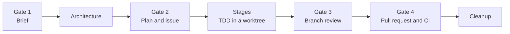

# Ferrule

**A spec-driven workflow for coding agents, enforced by one binary.**

ferrule turns a behavior change into a gated run: a brief, an architecture, a plan, test-driven stages in an isolated worktree, an independent review and a pull request. Each step is done by a dedicated agent and approved by you. The rules that hold it together (the task board, spec IDs, approvals, which git and GitHub calls are allowed) live in typed, tested Rust instead of in prompts and shell scripts, so an agent cannot quietly skip them.

> **Status:** early and under active development (v0.1). Commands and file formats may still change between releases.

## Contents

- [Motivation](#motivation)
- [Workflow](#workflow)
- [Quick start](#quick-start)
- [Installed files](#installed-files)
- [Commands](#commands)
- [Configuration](#configuration)
- [The guard](#the-guard)
- [Development](#development)

## Motivation

Coding agents are good at writing code and bad at following process. Ask one to work spec-first and it will, until a shortcut looks faster: a commit straight to main, a review it runs on its own code, a spec edited after the fact. Instructions alone do not hold.

ferrule moves the process out of the prompt:

- **State is on a board, not in the conversation.** Every step moves a card in `.ferrule/state.db`, so an interrupted run can be resumed, reconciled with git and the host, or rebuilt.
- **Instructions arrive per step.** After each agent reports, `ferrule gate next` names the one guide topic that applies now. No agent reads ahead or carries the whole workflow in context.
- **Mechanical steps are commands.** Commits, pushes, issues and PR bodies are assembled by ferrule from the run's files, never retyped by an agent.
- **Verification is re-run, not trusted.** A reported commit is checked, the gauntlet runs in the worktree, and the reviewer is always a different agent from the implementer.
- **Shortcuts are refused.** A shell guard blocks the raw git and `gh` calls ferrule replaces, and git hooks keep main untouchable whatever slipped through.

## Workflow

A run starts with `/fe-feature` in Claude Code. You approve at each gate; between gates, agents work on their own.



| Step | Agent | Produces |
|---|---|---|
| Gate 1: brief | `fe-author` | Scenarios, requirements and edge cases, grilled out of you one question at a time |
| Architecture | `fe-architect` | Types, modules, ownership and interactions, with a capped summary to approve |
| Gate 2: plan | `fe-planner` | Stages with files and dependencies, fixed spec IDs; on approval the tracking issue is filed and the worktree created |
| Stages | `fe-implementer` | Strict test-first commits, one stage at a time, pushed to a draft PR |
| Gate 3: review | `fe-reviewer` | An independent review against the spec, the architecture and the repo's standards |
| Gate 4: PR | `fe-author` | The final PR body and follow-up issues; the run ends when the PR is ready and CI is green |

Merging stays with you, outside the workflow.

**Lanes.** Small changes take the *fast* lane: fewer stops, with the brief, architecture and plan approved together. Larger changes take the *full* lane, with a stop at every gate. ferrule proposes a lane by size and you settle it at the first stop.

**Epics.** A feature too big for one run becomes an epic: its run settles the shared core and cuts the feature into slices, each filed as an issue and later done as a normal run.

### Entry points

| Skill | Use it to |
|---|---|
| `/fe-bootstrap` | Draft the first `PRD.md`, `ARCHITECTURE.md`, spec areas and gauntlet for a repository, once after install |
| `/fe-feature` | Drive one behavior change through the full workflow |
| `/fe-request` | Turn a requirement into an approved brief and a tracking issue, and stop there |
| `/fe-review` | Review someone else's open PR against its ticket's spec |

## Quick start

Install the binary, either from a [release](https://github.com/TumbleOwlee/ferrule/releases) (Linux and Windows builds) or with Cargo:

```sh
cargo install --git https://github.com/TumbleOwlee/ferrule --tag v<version> --locked ferrule
```

Set up a repository and commit what it writes:

```sh
cd <repository>
ferrule setup install
```

Then, in Claude Code:

1. Run `/fe-bootstrap` once, so the repository has a spec to work against.
2. Run `/fe-feature` with the change you want.

## Installed files

`ferrule setup install` detects the project's stack and writes:

| Path | Committed | What |
|---|---|---|
| `.ferrule/ferrule.toml` | yes | Project settings, created once with a gauntlet for the detected stack (and `glow` as viewer when on `PATH`); later runs only move `version` |
| `.ferrule/ferrule.lock` | yes | The installed version and the hash of every generated file and block |
| `.ferrule/ferrule` | yes | Shim the hooks call: runs `ferrule`, or refuses with the install command when it is missing |
| `.ferrule/.gitignore` | yes | Ignores the board, run files and worktrees |
| `.ferrule/lefthook.yml` | yes | The git hooks, when the project uses lefthook (an `extends` block is added to its config) |
| `.claude/agents/fe-{author,architect,planner,implementer,reviewer}.md` | yes | Identity, status line, never-do rules, the first `ferrule guide` topic |
| `.claude/skills/fe-{feature,request,review,bootstrap}/SKILL.md` | yes | The entry points |
| `.claude/settings.json` | yes | The hooks and the `permissions.deny` backstop, merged into the file |
| `AGENTS.md` | yes | A block between `<!-- ferrule:begin -->` and `<!-- ferrule:end -->` |
| `CLAUDE.md` | yes | An `@AGENTS.md` line when it has none |
| `docs/specs/README.md` | yes | The ID and numbering rules, when the file is missing |
| `.git/hooks/{pre-commit,commit-msg,pre-push}` | no | Without lefthook or husky |

**Upgrading.** Install the new binary and run `ferrule setup install` again. A generated file whose hash matches the lock is replaced; one you edited is kept, with the new version next to it as `<name>.ferrule-new`. A file at a generated path that ferrule never wrote is refused unless `--force`. `ferrule setup uninstall [--purge]` removes what was added.

**Version pinning.** The project records the version it was installed with. A binary whose version differs from `ferrule.toml` or `ferrule.lock` refuses every command but `setup` and names the fix: an older binary says which tag to `cargo install`, a newer one says to run `ferrule setup install` and commit the updated files.

## Commands

Commands are grouped by what they act on. Most are run by the orchestrating agent, not by hand; the ones you are likely to type yourself are `board list`, `run status` and `guide show`.

| Group | Covers |
|---|---|
| `setup` | Install, check and uninstall the project's ferrule files |
| `guide` | Show, list and check the workflow's instructions |
| `run` | Start, inspect, reconcile, rebuild, clean up and export runs |
| `gate` | Record approvals and name the next step |
| `stage` | Verify, commit, stop and re-plan implementation stages |
| `ci` | The local gauntlet and the PR's remote checks |
| `board` | Cards, fields and events in the state database |
| `spec` | Find, number and render spec entries |
| `file` | Read long markdown files by heading |
| `prompt` | Render the approval stops shown to you |
| `issue`, `pr` | Read, render and post issues, pull requests and review feedback |
| `hook` | The guards Claude Code and git call |

Every command prints `key=value` status lines and exits `0` done, `1` refused, `2` usage, `3` content, `4` internal error. A refusal ends in `hint=<fix>`. Documents are styled in a terminal and printed as plain markdown when piped.

The full list, with every flag, is in [docs/commands.md](docs/commands.md). Writing or overriding guide topics is covered in [docs/guide-topics.md](docs/guide-topics.md).

## Configuration

Everything that differs between projects lives in `.ferrule/ferrule.toml`. Every key is optional.

```toml
main_branch = "main"

[backend]
tracker = "github"           # github (gh) | jira (.ferrule/jira.local.json: baseUrl, email, apiToken)
host = "github"              # github (gh) | bitbucket (.ferrule/bitbucket.local.json: workspace, repoSlug, username, appPassword)
# The .local.json files must be mode 600; FERRULE_JIRA_CREDENTIALS or
# FERRULE_BITBUCKET_CREDENTIALS holding the same JSON is read instead when set.

[[gauntlet.step]]
name = "test"
cmd = ["cargo", "test", "--workspace"]
timeout = "30m"

[[gauntlet.step]]
name = "cov"
cmd = ["cargo", "llvm-cov", "--workspace", "--fail-under-lines", "80"]
coverage = "llvm-cov"        # how the pass's cov= is read from the output

[viewer]
command = ["glow"]           # prompt show appends the file path; unset: stdout

[guard]
allow = ["gh api"]           # raw calls the guard re-opens; see The guard

[hook.readonly]
mutating = ["cargo add"]     # word prefixes the reviewer's guard also refuses
allow = ["make check"]       # word prefixes it lets through; it runs only its read-only list otherwise

[thresholds]
read_budget = 3              # read events one stage card may carry
stage_stop_lines = 400       # a stage diff above this many changed lines stops
stage_stop_files = 8         # or touching more files than this
stage_stop_checkpoint = 3    # stages auto-continued in a row before one stops anyway
summary_max_lines = 25       # caps on *.summary.md and *.verdict.md
summary_max_bytes = 2048
search_max = 40              # spec related/refs and issue search refuse more hits
ci_wait = "2h"               # ci wait gives up on the PR's checks after this
```

### State

| Path | Holds |
|---|---|
| `.ferrule/state.db` | The board (SQLite), in the main checkout; commands in a worktree reach it through `git rev-parse --git-common-dir` |
| `.ferrule/runs/<slug>/` | A run's artifacts: brief, architecture, plan, reviews, PR text |
| `.ferrule/worktrees/<slug>/` | A run's git worktree |
| `.ferrule/guide/<topic>.md` | The project's overrides of guide topics |

A slug is ASCII letters, digits, `-`, `_` and single dots, starts with a letter or digit, is at most 64 bytes and never ends in `.`, `.lock` or `.s<n>`. `FERRULE_NOW` overrides the log timestamp.

## The guard

ferrule installs two layers that keep an agent on the workflow.

**The session guard** checks each Bash command's text before it runs. It refuses:

- writes to `.ferrule/state.db`, `.ferrule/ferrule.lock` and the settings the guard comes from (`.ferrule/ferrule.toml`, `.claude/settings.json`, `.claude/settings.local.json`), so an agent cannot switch it off. `Edit` deny rules cover the file tools too; you edit those files yourself.
- the raw git and `gh` calls ferrule replaces, naming the ferrule command to run instead.
- the usual ways around it, however they are spelled: wrappers, `sh -c` and `eval`, aliases, git settings and environment variables that run commands, interpreter one-liners, a script written and run in one call.

Some calls are refused only in some forms: `git update-ref` on branches, `gh api` when it writes, `gh run view` with `--log` or `--log-failed` (`ferrule ci failed` replaces those).

`[guard] allow` in `ferrule.toml` re-opens a call in the guard and the deny rules alike. An entry matches by whole words as a prefix of the command: `gh issue` re-opens every `gh issue …`, while `gh iss` re-opens nothing. An entry longer than the command (`git push --dry-run`) re-opens that form in the guard only, since a deny rule cannot express it. Each denied call gets an exact deny rule and one with arguments (`Bash(git merge)`, `Bash(git merge :*)`), so `git merge-base` stays open.

**What it is not: a sandbox.** It reads text and never runs it, so it cannot follow a program that builds a command at run time: a script written in an earlier call, code that assembles `git` and `push` from parts, a binary that calls git itself. A command it cannot read (`$'…'`, a variable where the program goes) it refuses rather than guess.

**The git hooks** are the enforcement that holds whatever ran. `pre-commit` and `pre-push` refuse the main branch, `commit-msg` strips attribution trailers, and `core.hooksPath`, which would bypass them, is refused by the guard.

## Development

ferrule is a Cargo workspace: `ferrule-core` holds the logic and the shipped guide topics, `ferrule` the command line.

```sh
cargo fmt --check
cargo clippy --workspace --all-targets -- -D warnings
cargo test --workspace
```

Golden tests compare a command's stdout and exit code with `ferrule/tests/fixtures/expected/<name>.out`. `UPDATE=1 cargo test` rewrites them from the current output; review every rewritten file before committing.

## License

[MIT](LICENSE)
